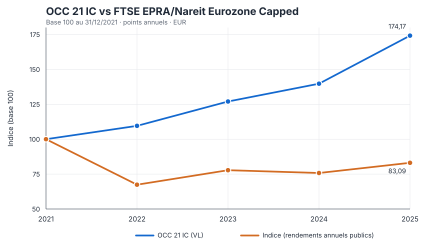

# Questionnaire Excel Gestion 21 — explication débutant + corrigé détaillé

**Classeur analysé : `Questionnaire Stagiaire.xlsx`**, transmis par lien Google Drive. J’ai vérifié ses trois onglets et leurs données. Ce guide suit l’ordre demandé : comprendre le fichier et le vocabulaire, puis résoudre les questions avec la formule, le sens financier et les limites.

> **Les chiffres ci-dessous sont calculés à partir du fichier fourni**, sauf la série d’indice de la question 3 et celle de taux de la question 6, qui ne figurent pas dans le classeur. Pour ces deux questions, je précise les sources et les hypothèses utilisées. Ce n’est pas un conseil en investissement : la question 7 est un exercice de raisonnement.

---

# 1. Le fichier, comme si tu débutais en finance

## En une phrase : qu’est-ce qu’un fonds ?

Un fonds rassemble l’argent de plusieurs investisseurs et l’investit dans un portefeuille d’actifs. La **valeur liquidative (VL)** est la valeur calculée d’une part de ce fonds à une date. Si la VL passe de 100 € à 110 €, la part a gagné 10 % sur cette période, avant toute autre considération.

En entretien, il ne suffit pas de calculer le pourcentage : il faut toujours vérifier **quel fonds, quelle part, quelles dates, quelle référence** et si les distributions sont incluses.

## Onglet `Instructions` — l’énoncé

L’onglet donne sept tâches et un petit tableau à compléter :

1. performance 2024 de la part **IC** d’**OCC 21** ;
2. performance **Year to date (YTD)** de la part **IC** d’**IMMOBILIER 21** ;
3. comparer OCC 21 à l’indice **FTSE EPRA/Nareit Eurozone Capped**, en base 100, entre le 31/12/2021 et le 31/12/2025 ;
4. performance et surperformance annualisées sur cinq ans de la part **AC** d’OCC 21 au 30/06/2026 ;
5. extraire des VL OCC 21 aux dates indiquées ;
6. calculer et commenter la relation entre les variations d’IMMOBILIER 21 et les taux ;
7. proposer trois sociétés qui pourraient correspondre au fonds ACTIONS 21.

Le tableau à remplir est en `B7:E13` : les dates sont en `B9:B13`, et les résultats attendus sont en `C:E` pour IC, ID et AC.

## Onglet `VL OCC 21 ` — historique OCC 21

Dans le nom interne de la feuille, il y a une espace finale après `21`. Les colonnes sont :

- `A` : date ;
- `B` : VL part IC ;
- `C` : VL part ID ;
- `D` : VL part AC ;
- `E` : VL part AD.

Les données commencent à la ligne 3 et vont jusqu’à la ligne 415. L’historique fourni commence le 27/12/2018 et va jusqu’au 15/10/2026. La VL du fonds est hebdomadaire dans une grande partie de l’historique : une date demandée peut donc ne pas être exactement une date de VL.

### Les codes des parts

Pour OCC 21, les documents du fonds indiquent que **IC et AC sont des parts de capitalisation** et **ID et AD des parts de distribution**. Une part de capitalisation laisse les revenus dans le fonds ; une part distributive verse des sommes au porteur selon les règles du fonds. Les parts I et A correspondent aussi à des catégories différentes, avec des conditions et frais différents : ne mélange pas les séries.

**Parallèle concret :** deux personnes peuvent investir dans le même fonds, mais l’une reçoit des versements sur son compte tandis que l’autre les laisse capitalisés dans sa part. Comparer uniquement les VL peut alors donner une image incomplète du rendement total.

## Onglet `VL IMMOBILIER 21` — historique IMMOBILIER 21

Même organisation :

- `A` : date ; `B` : IC ; `C` : ID ; `D` : AC ; `E` : AD.
- Données de la ligne 3 à la ligne 4733, du 27/11/2007 au 16/10/2026.

Le fonds investit dans des **actions de foncières cotées** : ce sont des sociétés immobilières en Bourse, pas des appartements détenus directement par l’investisseur. Leur cours peut réagir aux loyers et à la valeur des immeubles, mais aussi aux taux, au coût du financement, aux bénéfices et au sentiment de marché.

## Mini-dictionnaire Excel/finance

- **Cellule** : une case, désignée par une colonne et une ligne, par exemple `B321`.
- **Formule Excel** : commence par `=`. Une division suivie de `-1` transforme un rapport de valeurs en rendement.
- **Rendement** : variation relative, pas seulement l’écart en euros.
- **YTD / Year to date** : du dernier jour ouvré de l’année précédente jusqu’à la dernière date de données disponible.
- **Annualisé** : taux par an équivalent à un rendement composé sur plusieurs années.
- **Benchmark / indice de référence** : point de comparaison. Toujours vérifier qu’il correspond bien au fonds et qu’il inclut les dividendes selon la convention attendue.
- **Base 100** : ramener une série à 100 au départ pour comparer des courbes dont les niveaux initiaux sont différents.
- **Corrélation** : mesure si deux séries évoluent souvent ensemble ou en sens contraire ; elle ne prouve pas qu’une cause l’autre.

---

# 2. Corrigé détaillé des questions 1 à 5

## Question 1 — Performance 2024 de la part IC d’OCC 21

### Données exactes dans le fichier

- Début de période : dernière VL disponible au 31/12/2023, soit **29/12/2023**, ligne 268, IC = **8 802,87**.
- Fin de période : VL du **31/12/2024**, ligne 321, IC = **9 686,70**.

La VL du 31 décembre 2023 n’existe pas dans le tableau : on prend donc la dernière VL disponible avant la clôture.

### Formule

`=9686,70/8802,87-1`

Ou directement depuis les cellules :

`='VL OCC 21 '!B321/'VL OCC 21 '!B268-1`

Résultat : **+10,0402 %, soit +10,04 %**.

### Pourquoi cette formule ?

`VL finale / VL initiale` indique la valeur finale en proportion de la valeur initiale. Le `-1` enlève la valeur initiale : ce qui reste est la hausse ou la baisse. La différence en euros par part serait `9 686,70 − 8 802,87 = 883,83 €`, mais seule la division donne une performance comparable en pourcentage.

### Interprétation à dire

> « La part IC d’OCC 21 a progressé de 10,04 % entre la dernière VL disponible de 2023, le 29 décembre, et la VL du 31 décembre 2024. J’ai utilisé la variation de la VL, soit VL finale divisée par VL initiale moins un. »

Le résultat concorde avec le chiffre de performance 2024 publié par Gestion 21 pour OCC 21 IC. Cela sert de contrôle croisé, pas de remplacement du calcul à partir du classeur.

## Question 2 — Performance YTD de la part IC d’IMMOBILIER 21

Dans l’énoncé réel, il s’agit bien de **la part IC**, en YTD — ce n’est pas la part ID.

### Données exactes

- Dernière VL disponible avant 2026 : **31/12/2025**, ligne 4534, IC = **17 022,69**.
- Dernière VL du fichier : **16/10/2026**, ligne 4733, IC = **15 058,60**.

Le classeur ne va pas jusqu’au 31 décembre 2026 ; le résultat est donc le YTD **jusqu’au 16 octobre 2026**.

### Formule

`=15058,60/17022,69-1`

Ou depuis les cellules :

`='VL IMMOBILIER 21'!B4733/'VL IMMOBILIER 21'!B4534-1`

Résultat : **−11,5381 %, soit −11,54 %**.

### Interprétation

> « Du 31 décembre 2025 au 16 octobre 2026, la VL de la part IC d’IMMOBILIER 21 a baissé de 11,54 %. C’est une performance depuis le début de l’année jusqu’à la dernière observation du fichier, et non une performance sur l’année civile complète. »

Cela ne signifie pas que la stratégie ou la société a perdu exactement 11,54 % de son patrimoine immobilier : la VL d’une part de fonds est un indicateur de marché calculé selon les règles du fonds.

## Question 3 — OCC 21 et le FTSE EPRA/Nareit Eurozone Capped en base 100

### À quoi sert la base 100 ?

La VL d’OCC 21 est autour de plusieurs milliers d’euros ; l’indice a un niveau numérique différent. Comparer ces deux niveaux bruts n’a pas de sens. On met les deux séries à **100 au 31/12/2021**, puis on observe leur évolution.

Pour le fonds :

`Base 100 à la date t = VL IC à t / VL IC de départ × 100`

### Série OCC 21 extraite du classeur

| Date de référence | Date de VL retenue | VL IC | OCC 21 en base 100 |
|---|---|---:|---:|
| 31/12/2021 | 31/12/2021 | 6 931,69 | 100,00 |
| 31/12/2022 | 30/12/2022 | 7 594,73 | 109,57 |
| 31/12/2023 | 29/12/2023 | 8 802,87 | 126,99 |
| 31/12/2024 | 31/12/2024 | 9 686,70 | 139,75 |
| 31/12/2025 | 31/12/2025 | 12 072,63 | 174,17 |

Exemple de formule Excel, si la VL initiale se trouve en `B2` et la VL à comparer en `B3` :

`=B3/$B$2*100`

Les signes `$` figent la cellule de départ quand tu recopies la formule. Le fonds a progressé de **74,17 %** entre les observations retenues de fin 2021 et de fin 2025.

### Données de l’indice et convention

L’indice n’est pas dans le classeur. Pour faire un comparatif reproductible, j’ai utilisé les **rendements annuels du benchmark** FTSE EPRA/Nareit Eurozone Capped Net Return affichés dans la fiche officielle du fonds indiciel BNP Paribas au 31/08/2026 : 2022 −32,59 %, 2023 +15,41 %, 2024 −2,60 %, 2025 +9,65 %. Les valeurs d’indice en base 100 se reconstruisent en multipliant chaque année la base précédente par `1 + rendement annuel`.

| Date de base | Rendement annuel du benchmark appliqué | Indice en base 100 |
|---|---:|---:|
| 31/12/2021 | Base | 100,00 |
| 31/12/2022 | −32,59 % | 67,41 |
| 31/12/2023 | +15,41 % | 77,80 |
| 31/12/2024 | −2,60 % | 75,78 |
| 31/12/2025 | +9,65 % | 83,09 |

Formule pour les années suivantes :

`=base_100_année_précédente*(1+rendement_benchmark_année)`

> Petite différence de date à signaler : pour OCC 21, la dernière VL disponible de 2022 est datée du 30/12 ; le rendement annuel publié de l’indice est calendaire jusqu’au 31/12. Le graphique compare donc les fins d’année les plus proches disponibles, avec un décalage d’un jour en 2022.

### Comment faire le graphique dans Excel

1. Crée un petit tableau avec une colonne Date, une colonne OCC 21 base 100 et une colonne Indice base 100.
2. Sélectionne les trois colonnes et choisis **Insertion > Graphique en courbes**.
3. Mets un titre précis : « OCC 21 IC vs FTSE EPRA/Nareit Eurozone Capped — base 100 au 31/12/2021 ».
4. Nomme clairement la légende et l’axe vertical ; précise que les points sont annuels.

### Lecture financière

Sur les points annuels disponibles, OCC 21 passe de 100 à **174,17** tandis que le benchmark passe de 100 à **83,09**. L’écart final en base 100 est d’environ **91,08 points** ; les rendements cumulés correspondants sont +74,17 % pour le fonds et −16,91 % pour l’indice. Ce sont des performances passées, qui ne préjugent pas des performances futures.

**Limite importante :** le classeur ne contient pas les cours quotidiens de l’indice. Le tableau ci-dessus reconstitue une courbe **annuelle** à partir des rendements annuels publics du benchmark ; il ne prétend pas être une série quotidienne de niveaux d’indice. Pour une courbe journalière ou mensuelle, il faudrait importer l’historique public complet du même indice, dans la même devise et avec la même convention de dividendes nets réinvestis, puis comparer des dates alignées.

## Question 4 — Performance et surperformance annualisées sur cinq ans de la part AC

### Données du classeur

- Au 30/06/2021, dernière VL disponible avant cette date : **24/06/2021**, ligne 134, AC = **733,61**.
- Au 30/06/2026, dernière VL disponible avant cette date : **25/06/2026**, ligne 399, AC = **1 234,78**.

AC est une part de capitalisation : pour cette série, il n’y a pas de distribution à rajouter dans le calcul comme il faudrait l’examiner pour une part distributive.

### Rendement cumulé

`=1234,78/733,61-1 = 68,3156 %`

La part AC a donc gagné **68,32 % au total** sur les cinq années considérées.

### Rendement annualisé

Le rendement annualisé est le taux composé annuel qui relie les deux VL :

`=(1234,78/733,61)^(1/5)-1`

Résultat : **10,9749 %, soit 10,97 % par an**.

Contrôle intuitif : ce n’est pas `68,32 % / 5 = 13,66 %`. La capitalisation change le calcul : environ `1,1097^5 ≈ 1,6832`.

### Surperformance — que compare-t-on ?

Les documents d’OCC 21 indiquent un objectif annuel de **6 % pour les parts AC/AD** (à vérifier dans le prospectus applicable à la date de l’exercice). Le fonds indique ne pas chercher à répliquer un indice. En l’absence d’un autre benchmark donné dans l’énoncé, la lecture la plus défendable est donc de comparer l’AC à l’objectif annuel de 6 % :

`10,9749 % − 6,00 % = +4,9749 points de pourcentage par an`

**Surperformance annualisée par rapport à l’objectif : +4,97 points/an.** Sur cinq ans, 6 % composé donne `(1,06)^5−1 = 33,82 %`; le rendement observé de 68,32 % dépasse ce seuil cumulé d’environ **34,50 points**. L’objectif n’est pas une garantie et ne doit pas être appelé « indice de référence ».

### Phrase de réponse

> « La part AC est passée de 733,61 à 1 234,78 sur les dernières VL disponibles autour du 30 juin 2021 et du 30 juin 2026, soit +68,32 % cumulé et +10,97 % annualisé sur cinq ans. Par rapport à l’objectif annuel de 6 % indiqué pour cette catégorie de parts, l’écart annualisé est d’environ +4,97 points. Je précise que j’utilise l’objectif comme référence de calcul, pas comme une promesse ni comme un indice répliqué. »

## Question 5 — Remplir les VL aux dates demandées

La formule suivante peut être entrée en `C9`, puis recopiée vers la droite et vers le bas :

`=RECHERCHEX($B9;'VL OCC 21 '!$A$3:$A$415;'VL OCC 21 '!B$3:B$415;"Non trouvé";-1)`

- `$B9` fixe la colonne des dates tout en permettant de descendre de ligne en ligne.
- La plage de dates est triée de la plus ancienne à la plus récente.
- `-1` signifie : trouver la date exacte, ou la date immédiatement antérieure si aucune valeur n’existe exactement au jour cible.
- La plage de retour commence dans la colonne `B` : quand tu recopies vers la droite, Excel passe à `C` puis `D` pour ID et AC.
- La référence à la feuille est écrite avec une espace avant l’apostrophe finale car le nom interne de l’onglet OCC 21 finit par une espace.

### Résultats vérifiés

| Date demandée | Date de VL utilisée | IC | ID | AC |
|---|---|---:|---:|---:|
| 17/01/2019 | 17/01/2019 | 10 132,18 | 10 132,18 | 1 012,62 |
| 30/04/2020 | 30/04/2020 | 5 728,64 | 5 715,83 | 567,64 |
| 09/06/2021 | **03/06/2021** | 7 633,87 | 6 471,93 | 748,09 |
| 04/05/2023 | 04/05/2023 | 7 678,43 | 6 053,22 | 731,75 |
| 21/11/2024 | 21/11/2024 | 9 763,62 | 6 542,78 | 922,78 |

Pour le 09/06/2021, la formule trouve le 03/06/2021, la dernière VL antérieure. Il faut le signaler : ce n’est pas une valeur réellement calculée le 9 juin.

---

# 3. Questions d’analyse : méthode et réponse argumentée

## Question 6 — Corrélation entre l’immobilier coté et les taux

### Ce qui est dans le classeur et ce qui ne l’est pas

Le classeur comprend l’historique du fonds IMMOBILIER 21, mais **aucune colonne de taux**. Il faut donc choisir une série publique de taux et préciser ce choix. Comme proxy cohérent avec un fonds de foncières de la zone euro, j’ai utilisé le rendement moyen mensuel des obligations d’État à 10 ans de la zone euro, source ECB affichée par IndexBox. Ce n’est pas un facteur présent dans le fichier initial.

### Calcul reproductible

Pour éviter de corréler des niveaux de VL avec des niveaux de taux, j’ai comparé :

- le **rendement mensuel** de la part IC d’IMMOBILIER 21, calculé à partir de la dernière VL de chaque mois ;
- la **variation mensuelle** du taux moyen 10 ans de la zone euro, en points de pourcentage.

La période retenue est janvier 2021 à septembre 2026 pour les niveaux mensuels, soit **68 paires de variations mensuelles** de février 2021 à septembre 2026.

Dans un tableau de travail, si les dernières VL de chaque mois sont en `B` et les taux mensuels en `D` :

- rendement mensuel du fonds : `=B3/B2-1` ;
- variation du taux : `=D3-D2` ;
- corrélation (Excel français) : `=COEFFICIENT.CORRELATION(C3:C70;E3:E70)` — le nom exact de la fonction dépend de la langue/version d’Excel.

Résultat de cette définition : **r ≈ −0,525**, donc une relation linéaire négative modérée dans cet échantillon.

### Comment l’expliquer sans surinterpréter

Dans l’échantillon choisi, les mois où les taux 10 ans ont davantage monté ont eu tendance à coïncider avec des rendements mensuels plus faibles d’IMMOBILIER 21. C’est compatible avec l’intuition de marché : des taux plus élevés peuvent relever le coût de la dette des foncières, augmenter le rendement offert par les obligations concurrentes et diminuer la valeur actuelle de flux immobiliers futurs.

Mais ce n’est **pas** une loi ni une preuve de causalité. Les loyers, taux d’occupation, inflation, bénéfices, structure de dette, qualité des actifs, annonces des banques centrales et anticipation du marché peuvent renforcer ou annuler cet effet. Le résultat dépend aussi du proxy choisi, de la fréquence et de la période.

> **Réponse orale prudente :** « En prenant les rendements mensuels d’IMMOBILIER 21 IC et les variations mensuelles du taux moyen 10 ans de la zone euro entre janvier 2021 et septembre 2026, j’obtiens une corrélation d’environ −0,53 sur 68 observations. C’est une association négative modérée, cohérente avec la sensibilité des foncières aux taux, mais pas une preuve que les taux causent à eux seuls la performance. »

Pour une analyse plus robuste, refaire le calcul avec plusieurs proxys (OAT 10 ans, Bund 10 ans, taux souverains zone euro), plusieurs horizons et éventuellement une régression, sans oublier que les variables ne mesurent pas exactement la même chose.

## Question 7 — Trois sociétés cohérentes avec ACTIONS 21

### Ce que veut dire « avoir sa place » dans ce fonds

La page officielle présente ACTIONS 21 comme un fonds d’actions françaises multi-capitalisations à approche **value** : l’équipe fait de l’analyse fondamentale, accorde une place majeure à la valorisation et examine l’entreprise, son secteur et son management. Une bonne proposition doit donc relier **activité + fondamentaux + prix + risque**, et non seulement dire « l’entreprise est connue ».

Voici trois **exemples de dossiers à analyser**, pas des recommandations d’achat. Le rapport annuel 2025 mentionne déjà ces noms parmi les positions du fonds à la date du 31/12/2025 : BNP Paribas (6,80 %), Capgemini (5,94 %) et TotalEnergies (4,41 %). Il faut le dire si on les présente : ce ne sont pas des idées inédites ni nécessairement les positions actuelles de 2026.

### 1) BNP Paribas — banque diversifiée, idée value à tester

**Thèse à examiner :** grand établissement diversifié, rentabilité et génération de capital ; on peut étudier si le cours valorise insuffisamment la rentabilité normalisée par rapport aux fonds propres tangibles.

**Données pour ancrer la discussion :** en 2025, le groupe a publié 51,2 Md€ de revenus (+4,9 %), 12,2 Md€ de résultat net part du groupe (+4,6 %), un ROTE de 11,6 % et un ratio CET1 de 12,6 %. Au 30/06/2026, le ratio CET1 affiché était de 13,0 %.

**Ce que je vérifierais pour justifier “value” :** cours / bénéfice normalisé, cours / actif net tangible, ROTE par rapport au coût des fonds propres, qualité du portefeuille de crédit et exigences de capital. Un bénéfice élevé n’implique pas automatiquement une action sous-évaluée.

**Risque principal :** coût du risque en récession, taux, réglementation, risques de marché et d’exécution.

### 2) TotalEnergies — génération de cash et risque cyclique

**Thèse à examiner :** groupe intégré énergie, capable de générer du cash sur plusieurs segments ; on peut analyser si le marché applique une décote trop sévère à cause du cycle énergétique et de la transition.

**Données pour ancrer la discussion :** en 2025, TotalEnergies a déclaré 15,6 Md$ de résultat net ajusté (−15 % sur un an) et 27,8 Md$ de cash-flow opérationnel hors BFR (−7 %), dans un contexte de baisse des prix du pétrole. Le ROACE communiqué était de 12,6 %.

**Ce que je vérifierais pour justifier “value” :** valorisation d’entreprise / EBITDA à travers le cycle, rendement de cash-flow disponible après investissements, dette, coût d’équilibre et discipline d’allocation du capital.

**Risque principal :** prix du pétrole et du gaz, investissements lourds, réglementation et risque de transition énergétique. Une période de prix élevés ne doit pas être extrapolée mécaniquement.

### 3) Capgemini — qualité de cash-flow, mais valorisation et dette à contrôler

**Thèse à examiner :** société française de services numériques, exposition à des dépenses de transformation des entreprises ; une décote peut être intéressante si la croissance et les marges restent durables.

**Données pour ancrer la discussion :** en 2025, le chiffre d’affaires a atteint 22,465 Md€ (+1,7 % publié ; +3,4 % à taux de change constants), la marge opérationnelle était de 13,3 % et le cash-flow organique de 1,949 Md€. La dette nette publiée est passée de 2,107 Md€ à 5,306 Md€, ce qui mérite une analyse attentive. En juillet 2026, le groupe a relevé son objectif de croissance à taux de change constants à environ 8,5–9,0 % pour 2026, avec une contribution importante des acquisitions.

**Ce que je vérifierais pour justifier “value” :** EV/EBITA, rendement du cash-flow, croissance organique séparée des acquisitions, dette après acquisition et conversion du carnet de commandes en chiffre d’affaires.

**Risque principal :** demande des clients, pression sur les prix et marges, concurrence et incertitude sur l’effet de l’IA sur les volumes/prix des prestations.

### Une façon crédible de le présenter en entretien

> « Je commencerais par trois valeurs françaises de secteurs différents : BNP Paribas, TotalEnergies et Capgemini. J’ai vérifié que ces noms figuraient dans le portefeuille publié au 31 décembre 2025, donc je ne les présente pas comme des idées inédites. Pour chacune, je regarderais si le prix actuel rémunère correctement les bénéfices et cash-flows normalisés, le bilan et les risques. BNP offre un cas bancaire à analyser via ROTE, CET1 et coût du risque ; TotalEnergies un cas de génération de cash très cyclique ; Capgemini un cas de croissance, marge et cash-flow, avec une vigilance particulière sur la dette et la part acquise de la croissance. Sans valorisation à jour, je parle de dossiers à étudier, pas de titres que le fonds devrait acheter. »

Cette réponse montre l’esprit value et la prudence d’un analyste. Pour la personnaliser, remplace un nom par une société que tu connais réellement, puis apporte un chiffre de valorisation daté et une source récente.

---

# 4. Le jargon des calculs, avec parallèle de vraie vie

## Rendement simple vs gain en euros

- Gain en euros : `VL finale − VL initiale`.
- Rendement : `VL finale / VL initiale − 1`.

Le premier répond « combien d’euros par part ? », le second « de combien de pour cent l’investissement a-t-il varié ? ».

## Cumulé vs annualisé

- **Cumulé** : variation totale sur toute la période.
- **Annualisé** : rythme annuel composé équivalent.

Un compte qui passe de 100 à 121 sur deux ans a fait +21 % au total, mais environ +10 % par an composé, car `100×1,10×1,10 = 121`.

## Surperformance vs performance relative

- Soustraction de taux : `10,97 % − 6,00 % = +4,97 points par an`.
- Rendement relatif composé : `(1+10,97 %)/(1+6 %)−1`, une mesure différente.

Toujours dire quelle convention tu utilises. Et ne pas appeler un objectif de rendement « indice ».

## « Corrélation −0,53 » ne veut pas dire « −53 % »

La corrélation n’est pas un rendement, ni une probabilité, ni le pourcentage du fonds expliqué par les taux. Elle décrit la direction et la force d’une relation linéaire dans un échantillon précis.

---

# 5. Sources et conventions utilisées

- Classeur fourni : [Questionnaire Stagiaire.xlsx sur Google Sheets](https://docs.google.com/spreadsheets/d/1Tb-T8JE3wGIaj-5Sv7kZnXX1fYCoEwyl/edit).
- [OCC 21 — page officielle](https://gestion-21.fr/funds-occ-21/) et [prospectus OCC 21](https://gestion-21.fr/wp-content/uploads/2025/03/OCC21_Prospectus-06.03.2025.pdf) — parts, objectif de rendement et règles du fonds.
- [ACTIONS 21 — page officielle](https://gestion-21.fr/funds/actions-21/) et [rapport annuel 2025](https://gestion-21.fr/wp-content/uploads/2026/05/ACTIONS-21-Rapport-annuel-global-2025.pdf) — approche de gestion et principales positions au 31/12/2025.
- [Fiche officielle BNP Paribas Easy FTSE EPRA/NAREIT Eurozone Capped](https://docfinder.bnpparibas-am.com/api/files/0caa32b1-72e5-4471-93af-7e2ca59b6ac7/512) — rendements du benchmark et présentation de l’indice Net Total Return.
- [Historique mensuel du taux souverain 10 ans zone euro, affiché par IndexBox avec source ECB](https://app.indexbox.io/indicators/symbol/long-term-interest-rate-10-year-government-bond-yield-euro-area/) — proxy de taux utilisé pour la question 6.
- [Résultats 2025 et 2T 2026 de BNP Paribas](https://invest.bnpparibas/en/results), [résultats 2025 de TotalEnergies](https://totalenergies.com/newsroom/fourth-quarter-and-full-year-2025-results/?lang=eng), [résultats 2025 et perspectives 2026 de Capgemini](https://www.capgemini.com/news/press-releases/full-year-2025-results/).

*Les calculs reproduisent les données présentes dans le classeur et indiquent leurs conventions. Les performances passées ne préjugent pas des performances futures. Les idées de titres sont pédagogiques et ne constituent pas des recommandations.*
