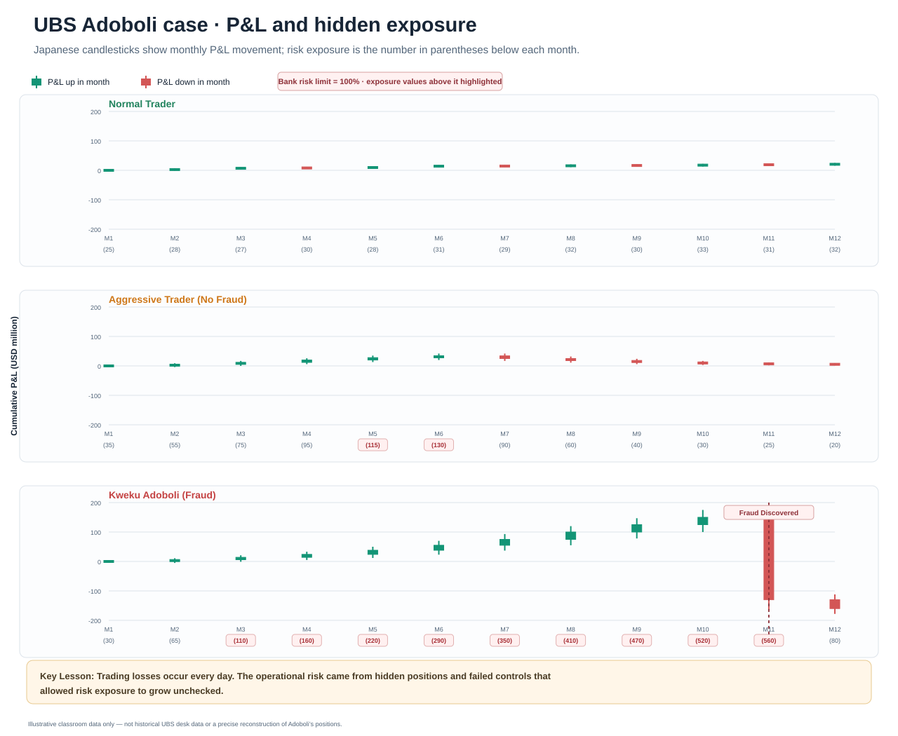
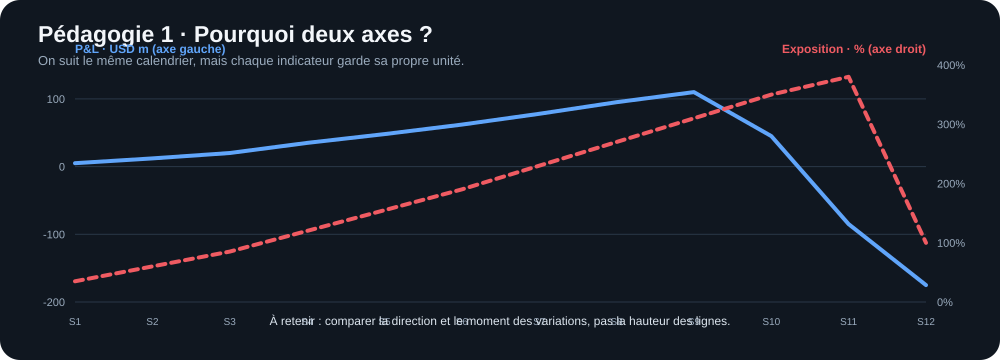
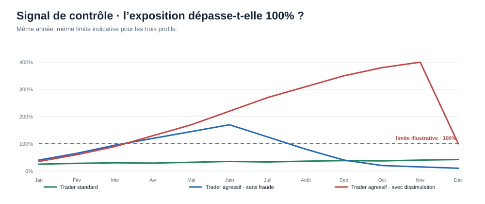

# UBS — P&L et exposition au risque

**Support de Calvin · 3 graphiques simples · présentation en ~45 secondes**

## 1 · Graphique principal à deux axes

Plein = P&L (axe de gauche, USD millions) ; tirets = exposition (axe de droite, % d’une limite hypothétique). Les couleurs distinguent les trois profils.

## 2 · Comprendre le double axe

**Message débutant :** les unités diffèrent ; on compare le moment et le sens des variations, pas la hauteur des courbes.

## 3 · Comprendre le signal d’alerte

**Message débutant :** les gains apparents ne prouvent pas que le risque est maîtrisé ; les positions peuvent déjà dépasser la limite.

## Script oral (~45 secondes)

> « Ce graphique compare trois comportements. Le trader normal garde un P&L et une exposition plutôt stables. Le trader très agressif sans fraude dépasse la limite, mais ses positions restent visibles : le contrôle peut intervenir. Dans le troisième cas, le P&L continue d’abord à monter tandis que l’exposition réelle explose. La fraude retarde la détection ; le gain affiché ne veut donc pas dire que le risque est maîtrisé. Attention aux deux axes : à gauche, le P&L en millions ; à droite, l’exposition en pourcentage d’une limite fictive. Les chiffres sont estimatifs et pédagogiques, pas des données UBS. »

**Données éditables pour Excel :** [CSV](ubs-calvin-data.csv). [Version HTML autonome](ubs-pnl-risk-calvin.html).

> **Précaution méthodologique :** les valeurs, trajectoires, semaines et limite sont des hypothèses pédagogiques, non des faits UBS. Il faut les sourcer et les valider avant de les présenter comme des données observées. Le scénario fraude montre l’exposition réelle supposée ; le CSV inclut aussi une colonne d’exposition déclarée fictive à titre d’explication.
