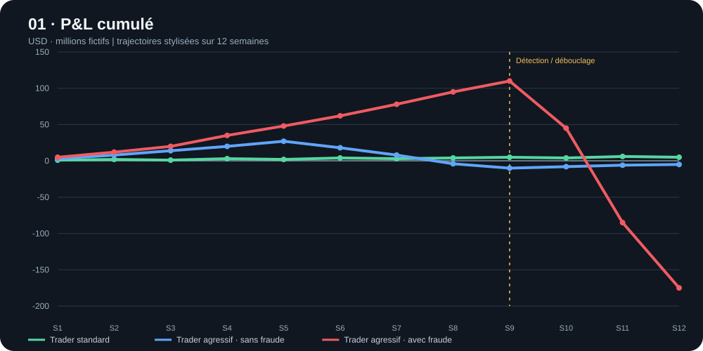
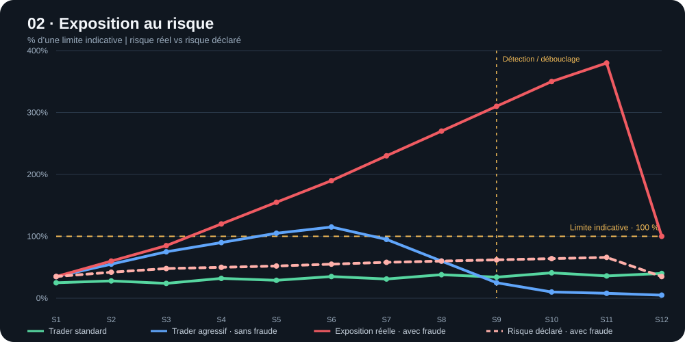

# UBS — P&L et exposition au risque

**Support de Calvin · deux graphiques comparatifs**

Les graphiques opposent trois profils : trader standard, trader agressif sans fraude et trader agressif avec dissimulation.

## 1. P&L cumulé

## 2. Exposition au risque

La ligne pointillée du scénario avec fraude représente le risque déclaré ; la ligne rouge pleine montre l’exposition réelle stylisée.

> **Précaution méthodologique :** toutes les valeurs, semaines, limites et courbes sont fictives et pédagogiques. Elles ne représentent ni des données internes d’UBS ni une reconstitution historique de l’incident. Ce sont des schémas analytiques, pas des résultats observés.

[Version HTML interactive/autonome](ubs-pnl-risk-calvin.html)
